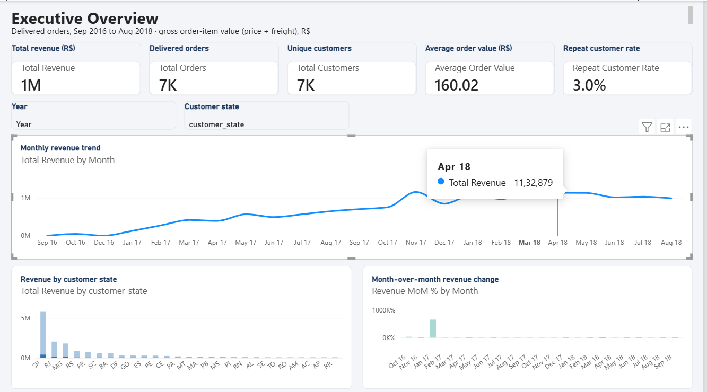
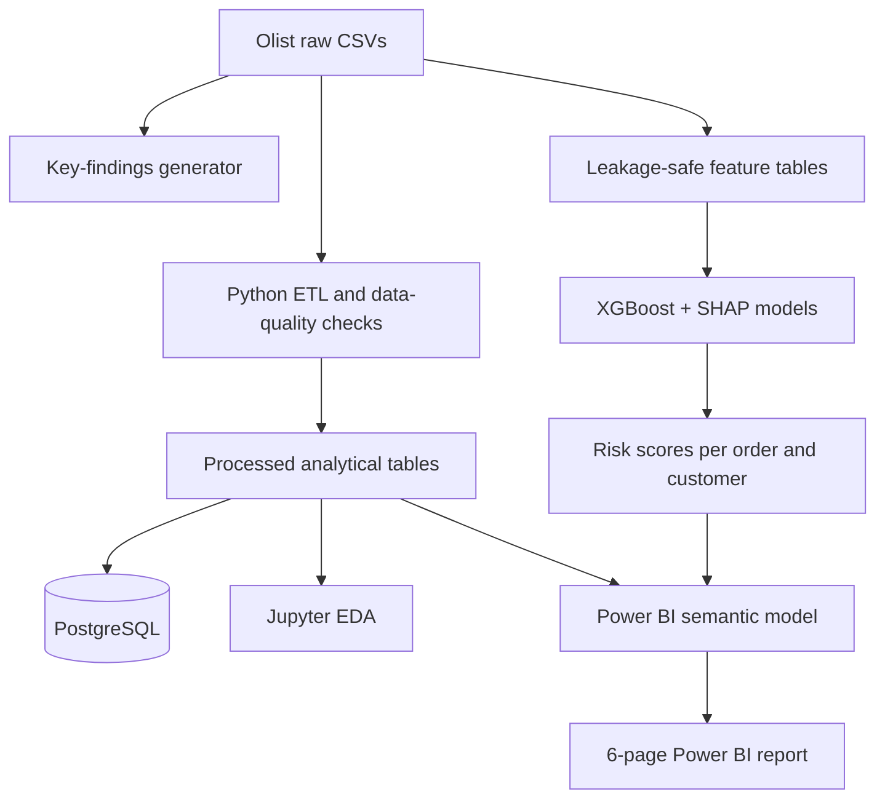
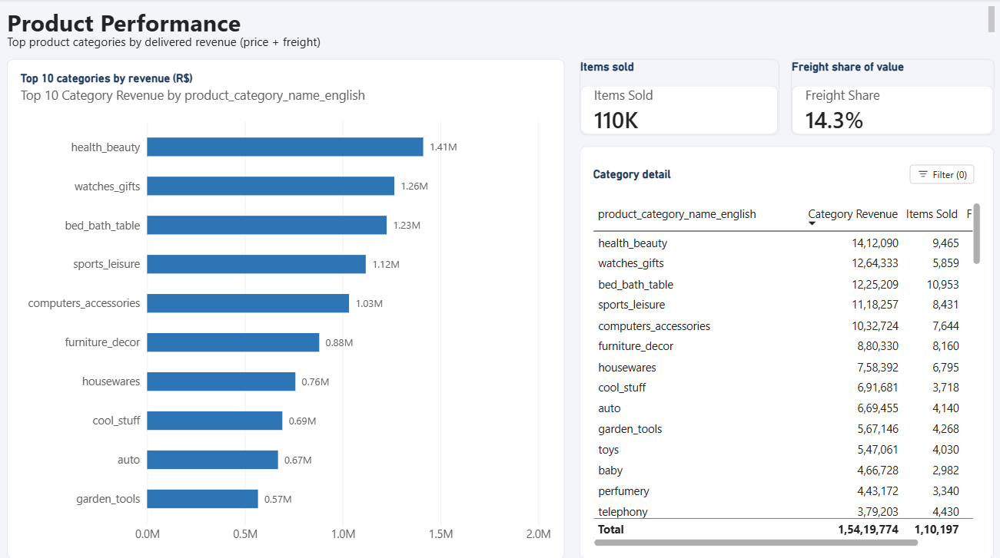
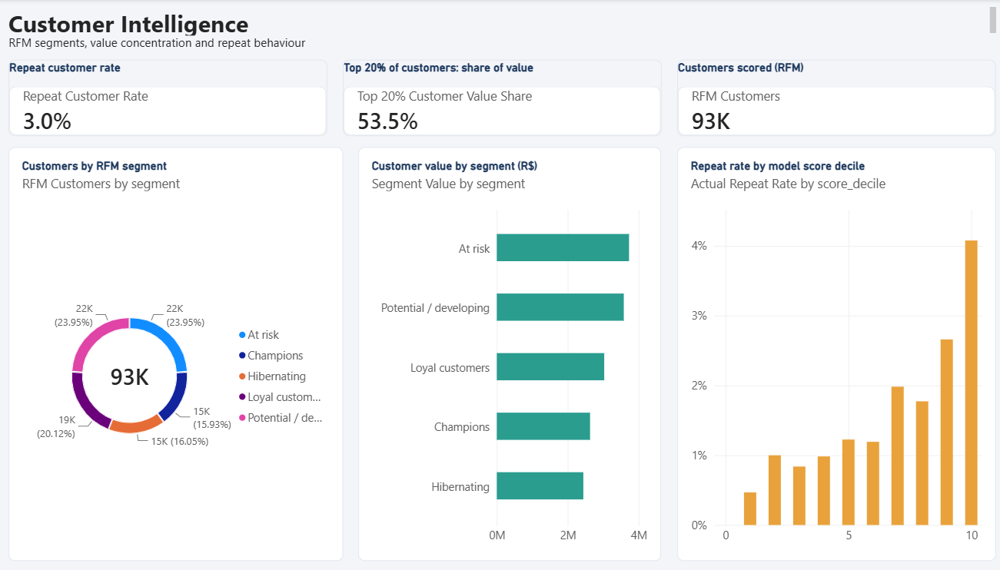
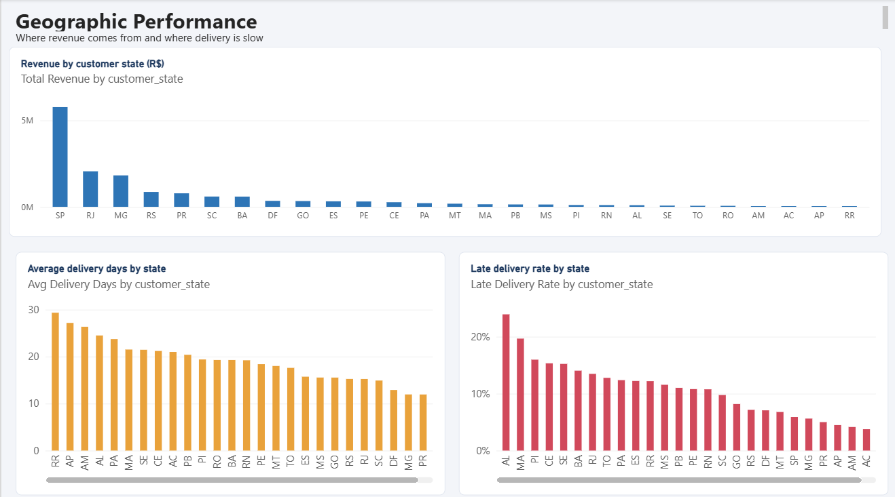
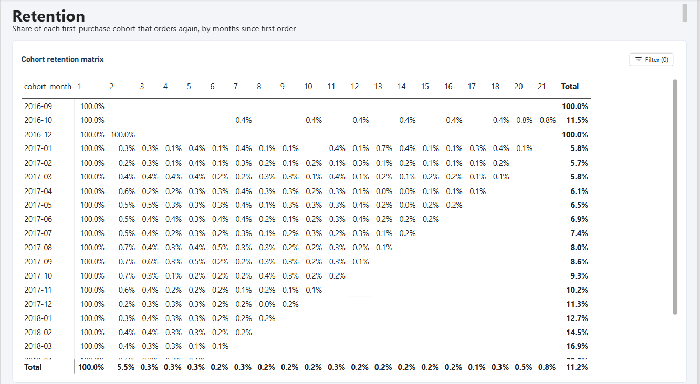
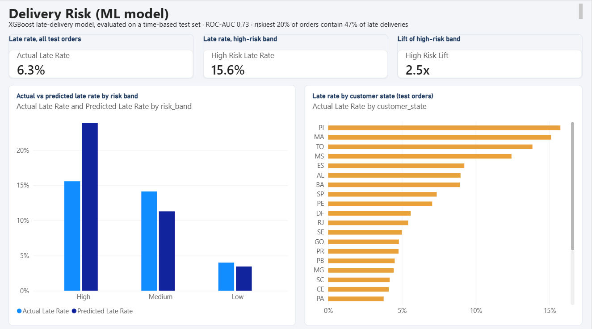
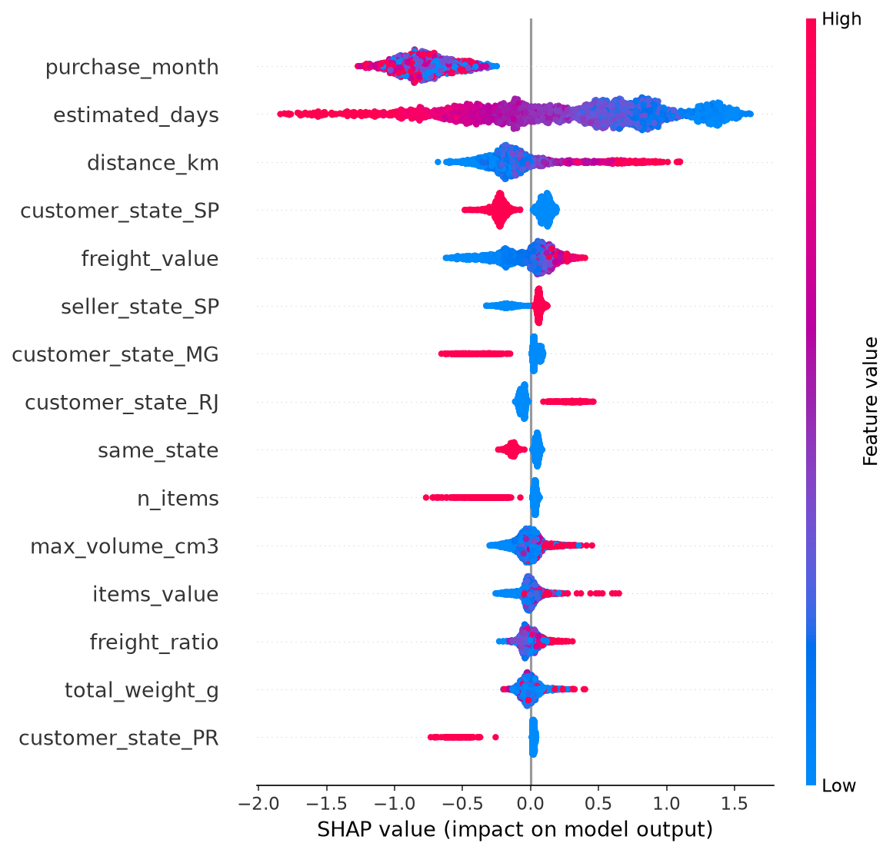

<div align="center">

# Enterprise E-Commerce Customer & Revenue Intelligence

### From raw transactions to customer, product, revenue and delivery-risk intelligence.

End-to-end analytics and machine-learning project on **96K real e-commerce orders**, built with
**Python · SQL · PostgreSQL · XGBoost · SHAP · Power BI · DAX**.

<br/>

[](https://github.com/Fariha12t/ecommerce-customer-revenue-intelligence/actions/workflows/ci.yml)
[](LICENSE)


</div>



---

## Key results

Dataset: the public [Olist Brazilian E-Commerce dataset](https://www.kaggle.com/datasets/olistbr/brazilian-ecommerce)
(96,478 delivered orders, September 2016 to August 2018). Values are in Brazilian reais (R$).

| Metric | Result |
|---|---|
| Gross order-item value (delivered) | **R$15.4M** |
| Delivered orders / unique customers | **96,478 / 93,358** |
| Average order value | **R$159.83** |
| Repeat-customer rate | **3.0%** (only 3 in 100 customers order twice) |
| Top 20% of customers' share of value | **53.5%** |
| Review score, late vs on-time delivery | **2.57 vs 4.29** |
| Late-delivery model (XGBoost, time-based test set) | **ROC-AUC 0.73** · riskiest 20% of orders contain **47%** of late deliveries (**2.5x** lift) |

Full auto-generated findings: [`reports/generated/key_findings.md`](reports/generated/key_findings.md)

---

## What the project answers

- Which categories and states generate the most value, and how does revenue move month to month?
- How are customers distributed across RFM segments, and how concentrated is customer value?
- How many customers come back, and how does retention differ by first-purchase cohort?
- Where is delivery slow, and how much does lateness hurt customer satisfaction?
- **Can late deliveries be predicted at checkout, early enough to act?**

---

## Solution architecture



**Workflow:** download → clean and transform (ETL) → load to PostgreSQL → analyse in SQL and Python →
train and explain models → publish a Power BI report with DAX measures.

---

## Dashboard (Power BI, 6 pages)

The report is stored as a Power BI Project in [`powerbi/EcommerceIntelligence/`](powerbi/EcommerceIntelligence/)
(open `EcommerceIntelligence.pbip`, then Refresh). Every visual has alt text and a defined tab order.

### 1. Executive Overview
KPI cards, monthly revenue trend, revenue by state, and month-over-month change. Revenue peaks in
November 2017 and then stabilises around R$1M a month.


### 2. Product Performance
Top 10 categories by revenue and a detail table. `health_beauty`, `watches_gifts` and `bed_bath_table`
lead; freight is 14.3% of order value.



### 3. Customer Intelligence
RFM segments, value concentration and repeat behaviour. The top 20% of customers drive 53.5% of value.
The decile chart shows actual repeat rate by model score, and includes customers the model was trained on,
so it overstates the signal (held-out ROC-AUC is 0.54, see below).



### 4. Geographic Performance
Revenue is concentrated in São Paulo (37% of value). Remote northern and north-eastern states have the
longest delivery times and the highest late rates.



### 5. Retention
Cohort matrix of repeat ordering by months since first purchase. Returning to buy is rare in every cohort
(typically well under 1% in any given month).



### 6. Delivery Risk (ML)
Out-of-sample results of the late-delivery model: orders in the high-risk band are late 15.6% of the time
against 6.3% overall.



---

## Predictive layer

### Late-delivery risk model (main model)

**Question:** at checkout, which orders are likely to arrive after the promised date?
Late delivery is the strongest driver of bad reviews (2.57 vs 4.29 average score), so catching it early is actionable:
re-promise the date, choose a faster carrier, or prioritise the order.

- **Prediction point:** purchase time. Features: basket value, weight and size, seller-to-customer distance
  (haversine on ZIP-prefix coordinates), same-state flag, promised delivery window, payment choice, calendar,
  category and state. Delivery timestamps and reviews are never used.
- **Evaluation:** time-based split (test set from 2018-05-05 onward, 24,118 orders), XGBoost compared with a
  logistic-regression baseline, explained with SHAP.
- **Output:** `reports/generated/ml_late/order_risk_scores.csv` (probability and High/Medium/Low band per order) feeds the Power BI risk page.

| Model | ROC-AUC | PR-AUC (base rate 6.3%) | Late rate, top 10% | Late orders caught in top 20% |
|---|---|---|---|---|
| Logistic regression | 0.711 | 0.123 | 13.1% | 36.8% |
| **XGBoost** | **0.734** | **0.136** | **16.0% (2.5x lift)** | **47.0%** |

**What drives lateness (SHAP):** purchase month (peak-season congestion), length of the promised delivery
window, seller-to-customer distance, São Paulo as customer state, and freight value.



**Reading the result honestly:** the model ranks orders well but its probabilities are not perfectly calibrated
(see the predicted-vs-actual chart), so use it to prioritise orders, not to quote exact probabilities.
With roughly 1,500 late orders in the test set, state-level late rates for small states are noisy.

```bash
python -m src.ml.late_delivery --no-mlflow
```

### Repeat-purchase model (exploratory, weak signal)

**Question:** which first-time customers will buy again within 180 days?

| Model | ROC-AUC | PR-AUC (base rate 1.3%) | Top-decile lift |
|---|---|---|---|
| Logistic regression | 0.583 | 0.018 | 1.34x |
| XGBoost | 0.543 | 0.015 | 1.39x |

Only ~1.3% of customers reorder inside the window, and first-order features carry little signal. With roughly 200
positive cases in the test set, the difference between the two models is not meaningful. This is a finding in
itself: **repeat behaviour cannot be predicted from first-order data, so retention levers have to come from the
post-purchase experience** (delivery quality, follow-up offers), not from targeting by first-order profile.

```bash
python -m src.ml.train --no-mlflow
```

Both models use leakage controls: features are known at the prediction point, splits are chronological,
and right-censored customers are removed. Optional experiment tracking: drop `--no-mlflow` and run `mlflow ui`.

---

## Business findings and recommended actions

| # | Finding | Evidence | Suggested action |
|---|---|---|---|
| 1 | Very few customers return | 3.0% placed 2+ delivered orders | Focus on the second purchase: post-delivery offers, review-triggered coupons |
| 2 | Value is concentrated | Top 20% of customers = 53.5% of value | Protect and grow the high-value RFM segments |
| 3 | Revenue is spread across many categories | Top 5 = health_beauty 9.2%, watches_gifts 8.2%, bed_bath_table 7.9%, sports_leisure 7.3%, computers_accessories 6.7% | Prioritise inventory and marketing on the leaders without over-concentrating |
| 4 | Geography is concentrated | SP 37.4%, RJ 13.3%, MG 11.8% of value | Expand logistics and seller supply in under-served states |
| 5 | Freight is a large share of value | 14.3% of gross order-item value | Test free-shipping thresholds and regional fulfilment |
| 6 | Late delivery hurts satisfaction | 8.0% of orders late; reviews 2.57 (late) vs 4.29 (on time) | Use the risk model to re-promise dates or expedite flagged orders |
| 7 | Strong seasonality and growth | Peak November 2017 (R$1.15M); Jan-Aug 2018 up 143% vs the same months of 2017 | Plan capacity and delivery promises around peak periods |

---

## Repository structure

```text
ecommerce-customer-revenue-intelligence/
├── .github/workflows/ci.yml        # lint + tests on every push
├── data/                           # raw/ and processed/ CSVs (not committed)
├── notebooks/exploratory_analysis.ipynb
├── powerbi/
│   ├── EcommerceIntelligence/      # Power BI Project: semantic model + 6-page report
│   ├── screenshots/                # dashboard screenshots used in this README
│   ├── dashboard_blueprint.md
│   └── measures.dax
├── reports/
│   ├── business_insights_template.md
│   └── generated/                  # key_findings.md, ml/ and ml_late/ metrics and SHAP plots
├── scripts/
│   ├── download_olist.py           # real data download (Kaggle)
│   ├── make_cohort_long.py         # cohort table in long format for Power BI
│   └── make_linux_requirements.py  # Linux-safe requirements for Docker/CI
├── sql/                            # schema.sql, analysis_queries.sql, final_validation.sql
├── src/
│   ├── etl.py, analytics.py, config.py, load_postgres.py, generate_data.py
│   ├── insights.py                 # auto-generated business findings
│   └── ml/                         # features.py, train.py, late_delivery.py
├── tests/                          # unit tests (metrics, features, models, insights)
├── Dockerfile, docker-compose.yml, Makefile, ruff.toml, LICENSE
└── requirements*.txt
```

---

## Quick start

```bash
git clone https://github.com/Fariha12t/ecommerce-customer-revenue-intelligence.git
cd ecommerce-customer-revenue-intelligence
python -m venv .venv
.venv\Scripts\Activate.ps1                 # macOS/Linux: source .venv/bin/activate
pip install -r requirements.txt -r requirements-ml.txt -r requirements-dev.txt
```

**Get the real data** (free Kaggle token required, see `scripts/download_olist.py`):

```bash
python scripts/download_olist.py
```

**Run the pipeline:**

```bash
python -m src.etl                          # clean data, build analytical tables
python -m src.analytics                    # KPIs, RFM, cohorts
python scripts/make_cohort_long.py         # cohort table for Power BI
python -m src.insights                     # reports/generated/key_findings.md
python -m src.ml.train --no-mlflow         # repeat-purchase model
python -m src.ml.late_delivery --no-mlflow # late-delivery model
python -m pytest -q                        # tests
```

**Open the dashboard:** open `powerbi/EcommerceIntelligence/EcommerceIntelligence.pbip` in Power BI Desktop,
set the `DataFolder` parameter to your local repository path (Home → Transform data → Manage parameters),
and click Refresh.

### Docker (optional)

```bash
python scripts/make_linux_requirements.py  # drops Windows-only packages
docker compose up --build                  # PostgreSQL + full pipeline
```

---

## PostgreSQL setup (optional)

PostgreSQL provides a queryable copy of the processed tables.

1. Create a database: `CREATE DATABASE ecommerce_intelligence;`
2. Copy `.env.example` to `.env` and fill in your local connection details. Never commit `.env`.
3. Load the tables: `python -m src.load_postgres` (it creates or replaces the project tables, so review it before running against a database you need to keep).

---

## Metric definitions

| Metric | Definition |
|---|---|
| **Gross order-item value** | Sum of item price plus freight for delivered order items. Not audited accounting revenue. |
| **Delivered orders** | Distinct orders whose status is `delivered`. |
| **Average order value** | Gross order-item value divided by distinct delivered orders. |
| **Repeat customer** | A customer with at least two delivered orders. |
| **RFM** | Recency, frequency and monetary scoring on delivered-order activity. |
| **Cohort** | Month of a customer's first delivered order; later activity is measured by period. |
| **Late delivery** | Delivered after the estimated delivery date. |
| **Risk band** | High / Medium / Low from the model's late probability (top 10% / next 20% / rest). |

---

## Data quality and modelling notes

- The order-item table has several rows per order, so orders are counted with distinct `order_id`.
- Payments and reviews are order-grain; they are aggregated before joining to avoid multiplying monetary values.
- Revenue measures use delivered orders only; missing categories are labelled `unknown`.
- Power BI measures that read model scores use the held-out test set only.
- Raw and processed CSVs, local credentials and `.pbix` files are excluded from Git.

---

## Scope and limitations

- Results describe the Olist dataset (Brazil, 2016 to 2018) and should not be generalised to other markets or periods.
- Gross order-item value is a project-defined metric, not audited revenue.
- Customer value is historical and descriptive, not a predictive lifetime-value model.
- Model quality is measured on one chronological hold-out of one public dataset; the late-delivery model ranks risk well
  but is not perfectly calibrated, and the repeat-purchase model has little predictive power.
- Production deployment, real-time scoring, automated report refresh and Power BI Service publication are outside the current scope.

---

## Tests and CI

```bash
python -m pytest -q
ruff check .
```

GitHub Actions runs lint and tests on every push (`.github/workflows/ci.yml`).

---

## Author

**Fariha Taneem**
Computer Science & Engineering · Data Analytics · AI/ML · Cloud

[GitHub](https://github.com/Fariha12t) · [LinkedIn](https://www.linkedin.com/in/fariha-taneem-249927253/)

---

<div align="center">

**Built to turn transactional data into clear, decision-ready insights.**

</div>
