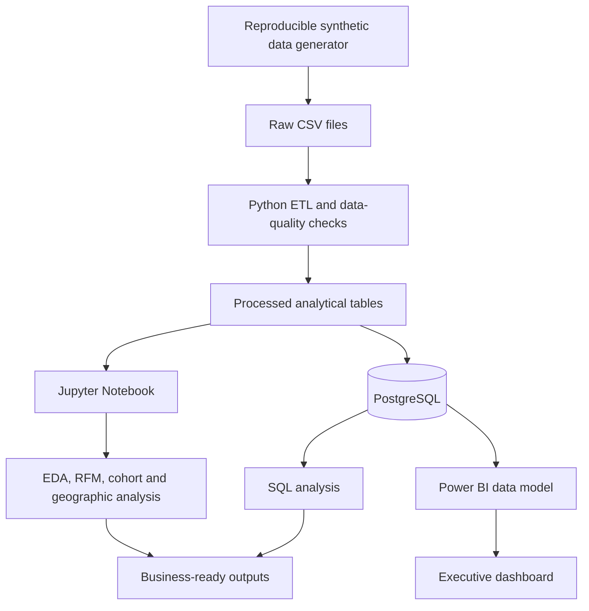

<div align="center">

#  Enterprise E-Commerce Customer & Revenue Intelligence

### From raw transactions to customer, product, revenue and geographic intelligence.

A portfolio-grade analytics engineering project built with **Python · PostgreSQL · SQL · Power BI · DAX · Plotly**.

<br/>


</div>

---

## Project at a glance

This project demonstrates an end-to-end e-commerce analytics workflow: generating a reproducible dataset, validating and transforming records, loading analytical tables into PostgreSQL, exploring business performance, and preparing an interactive Power BI report.

The analysis focuses on six business areas:

|  Revenue performance |  Product performance |  Customer intelligence |
|:---|:---|:---|
| Monthly revenue, orders and AOV | Category contribution and top products | RFM scoring and repeat purchasing |
|  Geographic performance |  Retention analysis |  Executive reporting |
| State and city comparisons | Cohort-based customer activity | KPI measures and dashboard design |

> **Dataset transparency:** The current working pipeline uses locally generated **synthetic Brazilian e-commerce data** with Olist-style CSV filenames and table structures. It is not the original Kaggle Olist dataset. This makes the project reproducible without downloading or redistributing customer records. All business findings should therefore be described as insights from the synthetic dataset, not from the real Brazilian e-commerce market.

---

##  What the project answers

- Which product categories and products generate the most gross order-item value?
- How do monthly revenue, delivered orders and average order value change over time?
- Which customers purchase repeatedly, and how are customers distributed across RFM segments?
- Which customer states and cities contribute the most to delivered order-item value?
- How does customer activity vary by first-purchase cohort?
- Which customers have the highest historical monetary value?

---

## Solution architecture



### Analytics workflow

1. **Generate** — create consistent synthetic customers, orders, items, products, sellers, payments and reviews.
2. **Transform** — clean source tables, standardise fields, validate locations and construct order-level and order-item-level analytical tables.
3. **Store** — load the processed tables into PostgreSQL.
4. **Analyse** — use SQL and Python to calculate KPIs, monthly trends, product/category performance, RFM segments, cohorts and geographic performance.
5. **Communicate** — build an executive Power BI report with DAX measures and interactive visuals.

---

##  Technology stack

| Area | Tools |
|---|---|
| Programming | Python |
| Data manipulation | Pandas, NumPy |
| Database | PostgreSQL |
| Querying | SQL |
| Exploration and visualisation | Jupyter Notebook, Plotly |
| Business intelligence | Power BI Desktop, DAX |
| Environment | VS Code, Python virtual environment, Git |

---

##  Repository structure

```text
ecommerce-customer-revenue-intelligence/
│
├── data/
│   ├── raw/                       # Generated source CSVs (not committed)
│   └── processed/                 # Clean analytical CSVs (not committed)
│
├── notebooks/
│   └── exploratory_analysis.ipynb # EDA, customer, product and geo analysis
│
├── powerbi/
│   ├── dashboard_blueprint.md     # Report layout and modelling guidance
│   ├── measures.dax               # Reusable DAX measure definitions
│   └── screenshots/               # Dashboard screenshots (add when ready)
│
├── reports/
│   ├── business_insights_template.md
│   └── generated/                 # Exported analysis results (not committed)
│
├── sql/
│   ├── schema.sql
│   └── analysis_queries.sql
│
├── src/
│   ├── generate_data.py           # Synthetic data generation
│   ├── config.py                  # Project paths and source-file mapping
│   ├── etl.py                     # Cleaning and analytical table creation
│   ├── analytics.py               # KPI, RFM and cohort analysis
│   └── load_postgres.py            # PostgreSQL loader
│
├── tests/
├── .env.example
├── .gitignore
├── requirements.txt
└── README.md
```

---

##  Run the project locally

### 1. Prerequisites

- Python 3.10 or newer
- PostgreSQL (optional, for database analysis)
- Git
- Power BI Desktop (optional, for the dashboard)

### 2. Clone the repository

```bash
git clone https://github.com/Fariha12t/ecommerce-customer-revenue-intelligence.git
cd ecommerce-customer-revenue-intelligence
```

### 3. Create and activate a virtual environment

**Windows PowerShell**

```powershell
python -m venv .venv
.venv\Scripts\Activate.ps1
```

**macOS / Linux**

```bash
python -m venv .venv
source .venv/bin/activate
```

### 4. Install dependencies

```bash
python -m pip install --upgrade pip
pip install -r requirements.txt
```

### 5. Generate the synthetic source data

Run this from the repository root:

```bash
python -m src.generate_data
```

The generator creates the source CSV files in `data/raw/`. The generated data is reproducible with a fixed random seed.

### 6. Run the ETL pipeline

```bash
python -m src.etl
```

The ETL step validates and cleans the source data, then writes processed tables to `data/processed/`.

### 7. Generate analytical outputs

```bash
python -m src.analytics
```

The analytics step exports business analysis results to `reports/generated/`, including executive KPIs, monthly performance, category performance, geographic performance, RFM/customer analysis and cohort outputs supported by the pipeline.

---

##  PostgreSQL setup

PostgreSQL is used to query the processed tables and provide a data source for Power BI.

### 1. Create a database

For example, create a database named:

```sql
CREATE DATABASE ecommerce_intelligence;
```

### 2. Configure environment variables

Copy `.env.example` to `.env` and update it with your local PostgreSQL connection details.

```dotenv
PGHOST=127.0.0.1
PGPORT=5432
PGDATABASE=ecommerce_intelligence
PGUSER=postgres
PGPASSWORD=replace_with_your_local_password
```

Keep `.env` private. Never commit passwords, tokens or connection secrets.

### 3. Run ETL before loading

```bash
python -m src.generate_data
python -m src.etl
```

### 4. Load the processed tables

```bash
python -m src.load_postgres
```

The loader reads the processed CSV files and creates/replaces the project tables in the configured database. Review the loader before rerunning it against a database containing data you need to preserve.

---

##  Analysis delivered

| Analysis | What it measures |
|---|---|
| Executive KPIs | Delivered gross order-item value, delivered orders, unique customers and AOV |
| Monthly performance | Revenue, delivered orders, units and month-over-month revenue movement |
| Product/category | Revenue contribution, order counts and units by category/product |
| Customer RFM | Recency, frequency, monetary value and customer segments |
| Repeat purchasing | Customers with at least two delivered orders |
| Cohort activity | Customer activity by first delivered-order month |
| Geographic performance | Revenue, orders and customers by customer state/city; seller-side analysis where available |

### Key metric definitions

| Metric | Definition |
|---|---|
| **Gross order-item value** | Sum of item price plus freight value for delivered order items. This is not audited accounting revenue. |
| **Delivered orders** | Distinct orders whose status is `delivered`. |
| **Average order value (AOV)** | Delivered gross order-item value divided by distinct delivered orders. |
| **Repeat customer** | A customer with at least two delivered orders. |
| **RFM** | Recency, frequency and monetary scoring based on delivered-order activity. |
| **Cohort** | Month of a customer's first delivered order; subsequent activity is measured by period. |
| **Historical customer value** | Observed historical monetary value, not a predictive customer lifetime value model. |

---

##  Power BI dashboard

The Power BI report is being developed in Power BI Desktop. The repository provides a dashboard blueprint and DAX measure reference.

### Planned report pages

| Page | Planned content |
|---|---|
| **Executive Overview** | Revenue, orders, customers, AOV, monthly revenue trend |
| **Product Performance** | Category contribution, top products, units sold |
| **Customer Intelligence** | RFM segments, repeat customer rate, customer value |
| **Geographic Performance** | State and city revenue comparisons, seller geography |
| **Retention Analysis** | Cohort activity and customer retention patterns |

### Connect Power BI to PostgreSQL

1. Open Power BI Desktop.
2. Select **Get data → PostgreSQL database**.
3. Enter the server as `127.0.0.1:5432`.
4. Enter the database as `ecommerce_intelligence`.
5. Choose the appropriate authentication method and connect.
6. Select the required tables and review relationships before building visuals.

Use `powerbi/dashboard_blueprint.md` and `powerbi/measures.dax` as references.

> **Dashboard status:** The `.pbix` report is a manual Power BI Desktop deliverable. It should only be described as completed after the report visuals, measures, filters and model have been validated and the `.pbix` has been saved. Add genuine report screenshots to `powerbi/screenshots/` when available.

---

##  Data quality and modelling considerations

- Customer and seller city/state values are generated as valid paired locations; location validation should return zero mismatches for the generated source.
- The order-item fact table contains multiple rows per order. Count orders using distinct `order_id`, not row count.
- Payments and reviews are order-grain tables, while order items are item-grain. Avoid joining multiple one-to-many tables directly without pre-aggregation, as this can multiply monetary values.
- Revenue measures should use delivered orders when reporting delivered sales.
- Missing product categories are represented as `Unknown` where applicable.
- Raw and processed CSVs, generated reports, local database credentials and Power BI `.pbix` files are excluded from Git where configured in `.gitignore`.

---

## Scope and limitations

- The current data is **synthetic**, generated locally for portfolio demonstration and repeatable development.
- Olist-style filenames are used for compatibility with the pipeline structure; this does not mean the current results were calculated from the original Kaggle Olist records.
- Synthetic results demonstrate analytical methods and should not be presented as real market research or evidence about actual customers.
- Gross order-item value is a business metric defined for this project, not audited accounting revenue.
- Historical customer value is descriptive and is not a predictive CLV model.
- A churn prediction model, production deployment, automated report delivery and Power BI Service publication are outside the current implemented scope.

---

##  Tests

Run the available tests from the repository root:

```bash
python -m pytest
```

If `pytest` is not installed in the environment:

```bash
pip install pytest
```

---

---

##  Author

**Fariha Taneem**
Computer Science & Engineering · Data Analytics · AI/ML · Cloud

[GitHub](https://github.com/Fariha12t) · [Project Repository](https://github.com/Fariha12t/ecommerce-customer-revenue-intelligence)

---

<div align="center">

**Built to turn transactional data into clear, decision-ready insights.**

</div>
