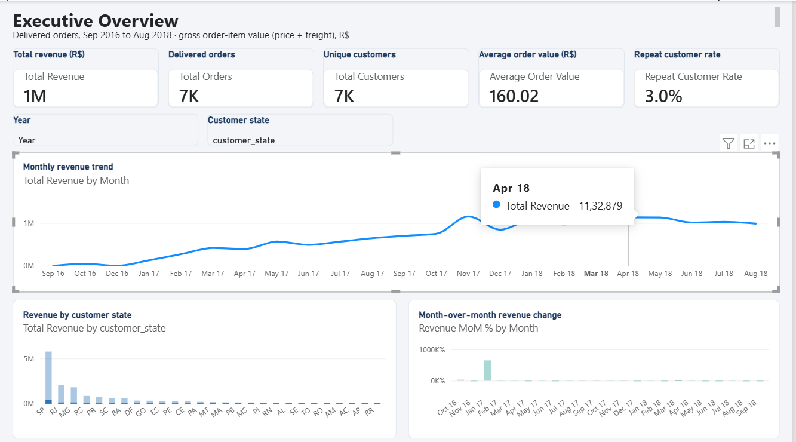
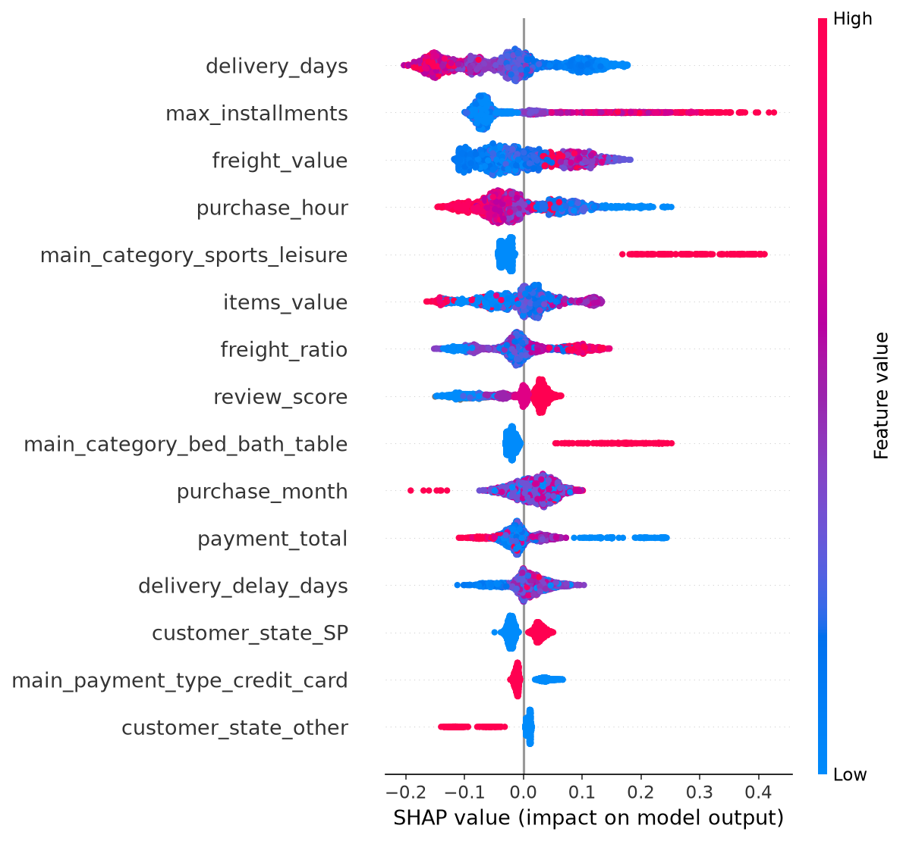

<!--
HOW TO USE THIS FILE
Paste each section below into your README.md (suggested positions are noted).
Fill every <PLACEHOLDER> with numbers from YOUR run:
  reports/generated/key_findings.md   -> business numbers
  reports/generated/ml/metrics.json   -> model numbers
Never publish a number you did not get from your own run.
Delete this comment block before committing.
-->

<!-- ===== 1. Replace the status badge line near the top ===== -->
[](https://github.com/Fariha12t/ecommerce-customer-revenue-intelligence/actions/workflows/ci.yml)
[](LICENSE)


<!-- ===== 2. Add directly under the title: dashboard preview + headline results ===== -->


## Key results

Dataset: Olist Brazilian E-Commerce (real public data, <N> delivered orders, <DATE> to <DATE>).

| Metric | Result |
|--------|--------|
| Gross order-item value | <VALUE> |
| Repeat-customer rate | <X.X%> |
| Top 20% of customers' share of value | <XX%> |
| Late deliveries vs review score | <X.XX> late vs <X.XX> on time |
| Repeat-purchase model (XGBoost, time-based split) | ROC-AUC <0.XX> · top-decile lift <X.Xx> |

Full auto-generated findings: [`reports/key_findings.md`](reports/key_findings.md)

<!-- ===== 3. Replace the "Dataset transparency" block ===== -->
> **Data:** the main analysis uses the real public
> [Olist Brazilian E-Commerce dataset](https://www.kaggle.com/datasets/olistbr/brazilian-ecommerce)
> (download with `make data-real`). A synthetic generator (`make data-demo`) is kept for tests,
> CI and quick demos only. Results marked as demo are not real market findings.

<!-- ===== 4. Add a new section after "Analysis delivered" ===== -->
## Predictive layer: repeat-purchase model

**Question:** which first-time customers are likely to buy again within 180 days?

- **Prediction point:** 7 days after the first order is delivered, so every feature is known at that moment.
- **Features:** basket value, freight ratio, payment type and instalments, delivery time and lateness,
  review score (only if answered before the prediction point), category, state, purchase timing.
- **Leakage controls:** time-based train/test split, right-censored customers removed, label counts only
  orders placed after the prediction point.
- **Models:** XGBoost compared with a logistic-regression baseline; explained with SHAP; runs tracked in MLflow.
- **Output:** `reports/generated/ml/customer_scores.csv` (probability and decile per customer) is loaded
  into Power BI for a "who to target" page.

| Model | ROC-AUC | PR-AUC | Top-decile lift |
|-------|---------|--------|-----------------|
| Logistic regression | <0.XX> | <0.XX> | <X.Xx> |
| XGBoost | <0.XX> | <0.XX> | <X.Xx> |



**Reading the result honestly:** repeat purchasing is rare in this dataset, so absolute precision is low;
the useful number is lift (how much better the top-scored 10% performs than the average customer).

```bash
python -m src.ml.train                 # trains, evaluates, writes reports/generated/ml/
python -m src.ml.train --horizon 90    # change the repeat window
```

<!-- ===== 5. Replace the "Run the project locally" intro with this quick start ===== -->
## Quick start

```bash
git clone https://github.com/Fariha12t/ecommerce-customer-revenue-intelligence.git
cd ecommerce-customer-revenue-intelligence
make setup          # dependencies
make data-real      # real Olist data (Kaggle token required, see scripts/download_olist.py)
make pipeline       # ETL + analytics + key findings + ML model
make test           # unit tests
```

Or run everything including PostgreSQL with one command:

```bash
docker compose up --build
```

<!-- ===== 6. Replace the "Scope and limitations" bullet about churn ===== -->
- A repeat-purchase model is included; a production deployment, real-time scoring and
  automated report refresh are outside the current scope.
- Model performance is measured on a time-based hold-out of one public dataset and should not be
  assumed to transfer to another business.

<!-- ===== 7. Replace the repository structure additions ===== -->
<!--
├── .github/workflows/ci.yml       # lint + tests on every push
├── scripts/download_olist.py      # real data download
├── src/insights.py                # auto-generated key findings
├── src/ml/features.py             # leakage-safe feature table
├── src/ml/train.py                # XGBoost + SHAP + MLflow
├── tests/                         # unit tests (features, model, insights)
├── Dockerfile, docker-compose.yml, Makefile, LICENSE
-->
